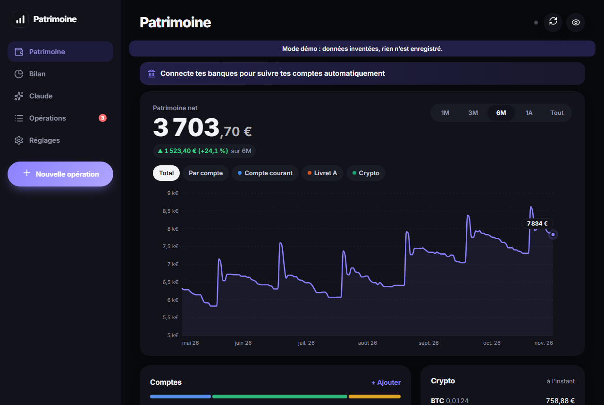
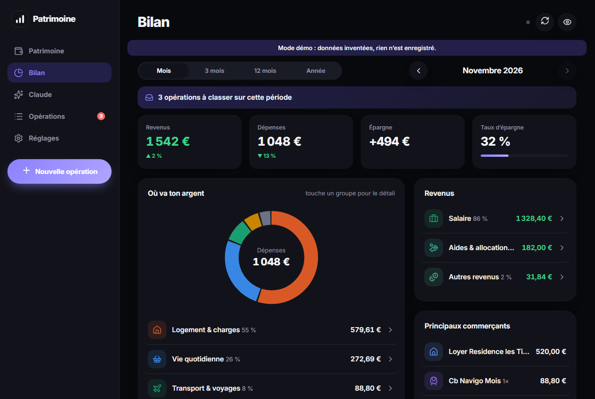
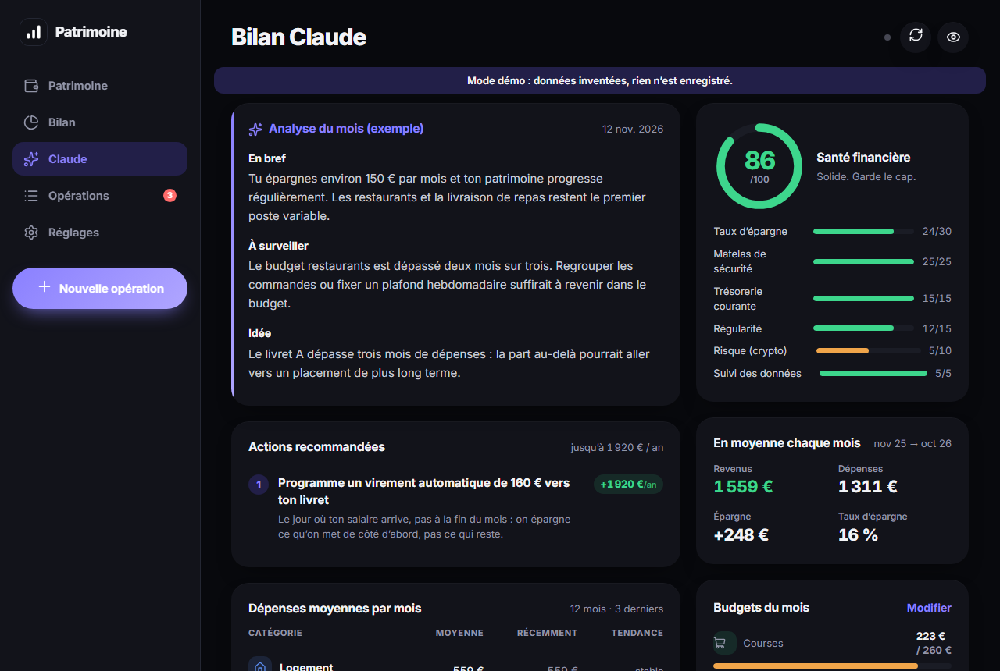

# Patrimoine

[](https://github.com/medmehdimobtahij-ship-it/patrimoine/actions/workflows/demo.yml)

My bank app only shows one bank. My savings and my crypto don't show up anywhere.
I wanted a single view of everything I own and of where my money goes each month, without handing my data to yet another app. So I made one.

I use it every day on my phone.

**[Try the demo](https://medmehdimobtahij-ship-it.github.io/patrimoine/)**, nothing to install, fake data, nothing is saved.



| Monthly summary | Spending analysis |
|---|---|
|  |  |

## What it does

- net worth over time, and a click on the chart explains what changed
- income, spending and savings rate per month, by category
- budgets, and a financial health score with concrete suggestions
- bank statement import (Revolut, BNP…) with duplicate detection and automatic categories
- bank sync through open banking, crypto through Binance (read-only)
- live sync between my phone and my computer
- works offline, installable like an app

## How it's built

Plain JavaScript on the front, no framework.
A small Cloudflare Worker sits in the middle, so API keys never reach the browser. It also keeps my devices in sync over WebSocket.

```
Phone / PC (PWA)  ──HTTPS + WebSocket──►  Cloudflare Worker  ──►  Durable Object (state, live sync)
                                              ├──► Binance (signed requests, read-only)
                                              └──► Enable Banking (open banking)
```

## Try it locally

With Node.js 18+:

```bash
./demo.sh        # or demo.bat on Windows
```

Then open http://localhost:8787/?demo. The demo loads 14 months of fake transactions.

Tests: `npm test`

The interface is in French.

MIT licence. Made by Mehdi Mobtahij.
