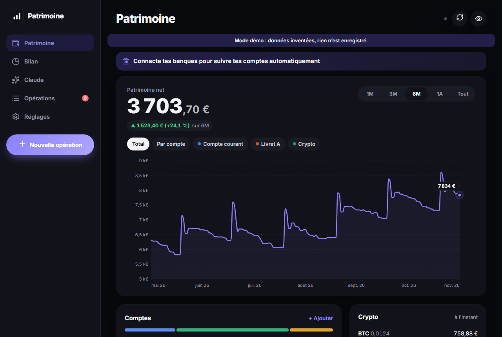
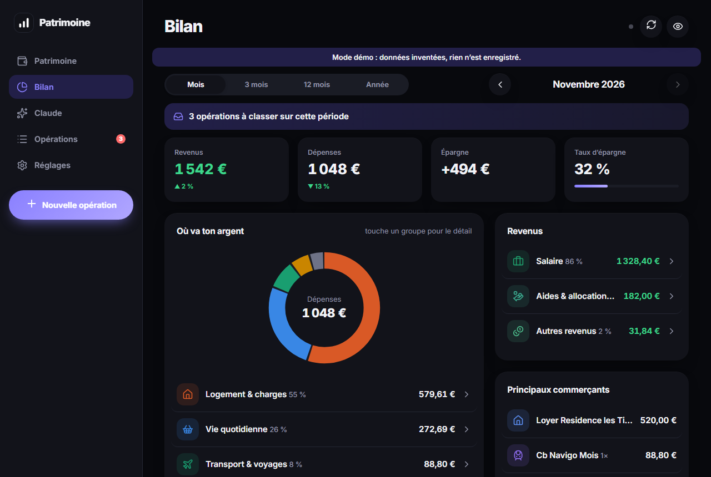
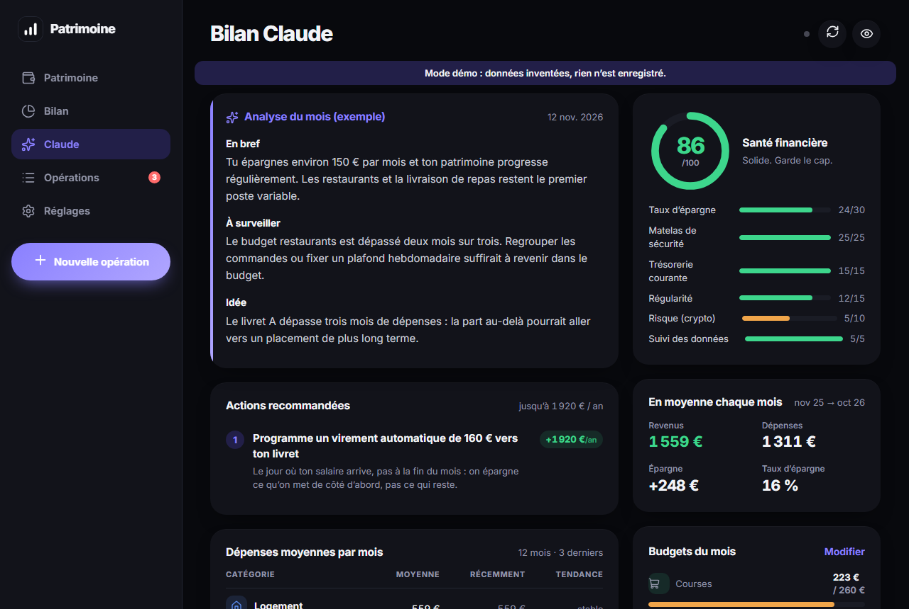

# Patrimoine

[](https://github.com/medmehdimobtahij-ship-it/patrimoine/actions/workflows/demo.yml)

Application web installable (PWA) pour suivre son patrimoine et ses dépenses : soldes de tous les comptes, courbe du
patrimoine net, bilan mensuel par catégorie, budgets et analyse automatique des habitudes de dépense.

Écrite en JavaScript sans framework ni dépendance côté client, avec un petit backend **Cloudflare Workers** (relais
Binance signé, open banking, synchronisation temps réel entre appareils). Je l'utilise tous les jours sur mon téléphone ;
ce dépôt contient le code complet et un **mode démo** avec des données inventées.

**▶ Démo en ligne : [ouvrir la démo](https://medmehdimobtahij-ship-it.github.io/patrimoine/)** : rien à installer, données fictives, rien n'est enregistré.



| Bilan du mois | Analyse et score de santé financière |
|---|---|
|  |  |

## Le besoin

Les applis bancaires ne montrent qu'une banque à la fois, et l'épargne réglementée ou la crypto n'y apparaissent pas.
Je voulais **une seule vue** : tous les comptes, l'évolution du patrimoine dans le temps, et où part l'argent chaque mois,
sans confier mes données à une appli tierce.

## Fonctionnalités

- **Patrimoine** : patrimoine net et courbe sur 1 mois à « tout », par compte ou au total, avec la répartition par type
  (courant, épargne, crypto, investissement). Un clic sur un point de la courbe explique la variation (quelles opérations).
- **Bilan** : revenus, dépenses, épargne et taux d'épargne par mois, trimestre ou année ; dépenses par groupe et catégorie,
  principaux commerçants, dépenses récurrentes détectées automatiquement.
- **Analyse** : score de santé financière sur 100 (taux d'épargne, matelas de sécurité, régularité, exposition crypto…),
  actions recommandées chiffrées en € par an, mois en déficit, grosses dépenses ponctuelles, suivi des budgets.
- **Opérations** : import de relevés CSV (Revolut, BNP…) avec détection des doublons, classement automatique par règles de
  mots-clés (la plus longue l'emporte), boîte « à classer », labels (#vacances), ventilation d'une opération en plusieurs parts.
- **Synchronisation** : banques via l'open banking (Enable Banking, PSD2), crypto via l'API Binance en lecture seule,
  et synchro **en direct** entre téléphone et ordinateur (WebSocket).
- **Hors ligne** : service worker, données en IndexedDB, installable sur Android et iOS ; mode « montants masqués ».

## Stack et architecture

| Couche | Choix |
|---|---|
| Interface | JavaScript ES modules, HTML/CSS sans framework, graphiques SVG faits main, icônes Lucide embarquées |
| Logique métier | `public/core.js` : fonctions pures (soldes, séries, statistiques, règles, import), testées sans navigateur |
| Stockage | IndexedDB sur l'appareil ; copie de référence dans un Durable Object Cloudflare |
| Backend | Cloudflare Worker (`src/worker.js`) : sert l'app et relaie les appels qui demandent un secret |
| Temps réel | Durable Object `SyncRoom` (`src/sync.js`) : état partagé + WebSocket qui prévient les autres appareils |
| Banques | `src/eb.js` : API Enable Banking, authentification par JWT RS256 signé avec WebCrypto |

```
Téléphone / PC (PWA)  ──HTTPS + WebSocket──►  Cloudflare Worker  ──►  Durable Object (état, temps réel)
   IndexedDB, hors ligne                          │  secrets côté serveur
                                                  ├──► Binance (requêtes signées HMAC-SHA256, lecture seule)
                                                  └──► Enable Banking (open banking PSD2)
```

Quelques choix :

- **Aucun secret dans le navigateur** : les clés Binance et Enable Banking restent dans le Worker (`wrangler secret`) ;
  l'app ne détient qu'un mot de passe d'accès au relais.
- **Conflits entre appareils** : la version la plus récente gagne, et un appareil vide n'écrase jamais le cloud.
- **Opérations « en attente »** : elles comptent dans les statistiques sans fausser le solde affiché par la banque.

## Essayer en 30 secondes

Avec Node.js 18+ (aucune dépendance à installer) :

```bash
# Windows
demo.bat

# Linux / macOS
./demo.sh

# ou à la main
node tools/serve.mjs      # puis ouvrir http://localhost:8787/?demo
```

Le mode démo charge 14 mois d'opérations fictives (profil d'alternant, dates recalculées à partir d'aujourd'hui).
Rien n'est enregistré, aucun appel réseau n'est fait. La même démo est publiée sur GitHub Pages à chaque push
(`.github/workflows/demo.yml`).

## Installation réelle (Cloudflare, gratuit)

```bash
npm install
npx wrangler login
npx wrangler kv namespace create DATA   # reporter l'id obtenu dans wrangler.toml
npm run deploy                          # affiche l'adresse https://patrimoine.<compte>.workers.dev
npx wrangler secret put APP_TOKEN       # mot de passe de l'app (long, inventé)
npx wrangler secret put BINANCE_KEY     # optionnel : clé API Binance en lecture seule
npx wrangler secret put BINANCE_SECRET
npx wrangler secret put EB_APP_ID       # optionnel : application Enable Banking
npx wrangler secret put EB_PRIVATE_KEY  # contenu du fichier .pem
```

Ouvrir l'adresse dans Chrome, « Installer l'application », puis saisir `APP_TOKEN`.
En local : `npm run dev` (secrets dans `.dev.vars`, jamais versionné).

## Tests

```bash
npm test
```

21 tests sans navigateur ni réseau : lecture des montants et libellés bancaires, règles de classement, soldes et séries,
migrations de l'état, import bancaire sans doublon, opérations en attente, ventilation et prêts, analyse et budgets,
signature JWT et routes du relais bancaire (API simulée).

## Licence et auteur

Code sous licence MIT (voir `LICENSE`). Auteur : **Mehdi Mobtahij**.
